# Doctavia Routing Map

This document outlines the routing structure and page flow of the Doctavia Flutter application. It serves as a guide for navigation logic and a tool to identify orphaned or disconnected screens.

## 1. Routing Tree Visualization

```mermaid
graph TD
    %% Auth & Entry
    Root["/ (Root Redirect)"] --> Onboarding["/onboarding"]
    Root --> Login["/login"]
    Root --> Signup["/signup"]

    %% Patient Shell
    subgraph Patient_Experience ["Patient Role"]
        PHome["/home (Dashboard)"]
        PSearch["/search (Doctor Discovery)"]
        PBookings["/bookings (My Appointments)"]
        PVault["/vault (Medical Records)"]
        PProfile["/profile (Personal Profile)"]
        PMap["/map (Geographic Search)"]
        PNotifs["/notifications"]
        PBilling["/billing"]
        PReminders["/reminders"]
        PChat["/chat (Secure Messaging)"]
        
        PSearch --> PSearchDetail["/search/doctor/:id"]
        PSearch --> PFavorites["/search/favorites"]
        PBookings --> PReview["/bookings/review/:id/:name"]
        PVault --> PAudit["/vault/audit (Access Logs)"]
        PReminders --> PRemindersAdd["/reminders/add"]
    end

    %% Doctor Shell
    subgraph Doctor_Experience ["Doctor Role"]
        DHome["/dashboard (Clinical Home)"]
        DSched["/schedule (Availability)"]
        DPatients["/patients (Registry Queue)"]
        DProfile["/doctor/profile (Professional)"]
        DConsult["/consultation/:apptId (SOAP)"]
        DNotifs["/notifications"]
        
        DProfile --> DOffices["/doctor/profile/offices"]
        DProfile --> DEditProf["/doctor/profile/edit-professional"]
    end

    %% Secretary Shell
    subgraph Secretary_Experience ["Secretary Role"]
        SHome["/secretary (Front Desk)"]
        SRegistry["/registry (Full Dashboard)"]
        SStats["/stats (Clinic Analytics)"]
        SProfile["/secretary/profile"]
    end

    %% Shared Settings
    subgraph Shared_Settings ["Shared Configuration"]
        Settings["/settings (Unified)"]
        Settings --> S_ProfileEdit["/settings/profile"]
        Settings --> S_Security["/settings/security"]
        Settings --> S_ChangePwd["/settings/change-password"]
        Settings --> S_Help["/settings/help"]
        Settings --> S_Privacy["/settings/privacy"]
    end

    %% Global Connections
    Root -.-> PHome
    Root -.-> DHome
    Root -.-> SHome
    PHome --> Settings
    DHome --> Settings
    SHome --> Settings
```

## 2. Detailed Route Registry

| Path | Screen Widget | Purpose | Access Role |
| :--- | :--- | :--- | :--- |
| `/onboarding` | `ScreenOnboarding` | Welcome & Initial Setup | Guest |
| `/login` | `ScreenAuthLogin` | Authentication | Guest |
| `/signup` | `ScreenAuthSignup` | New Account Creation | Guest |
| **PATIENT ROUTES** | | | |
| `/home` | `ScreenHomePatient` | Patient Dashboard | Patient |
| `/search` | `ScreenSearchList` | Search & Filters | Patient |
| `/search/doctor/:id` | `ScreenSearchDetails` | Doctor Bio & Slot Booking | Patient |
| `/search/favorites` | `ScreenSearchFavorites`| Saved/Bookmarked Providers | Patient |
| `/map` | `ScreenSearchMap` | Geographic Search | Patient |
| `/bookings` | `ScreenAppointmentsBookings` | Appointment Listing | Patient |
| `/bookings/review/:id/:name`| `ScreenAppointmentsReview` | Submit Patient Review | Patient |
| `/profile` | `ScreenProfilePatient` | Personal Profile | Patient |
| `/vault` | `ScreenVaultDashboard` | Medical Record Management | Patient |
| `/vault/audit` | `ScreenVaultAccessLogs` | Detailed Access Transparency | Patient |
| `/reminders` | `ScreenRemindersList` | Medication/Visit Reminders | Patient |
| `/reminders/add` | `ScreenRemindersAdd` | Add Reminder | Patient |
| `/billing` | `ScreenBillingInvoices` | Payment Tracking | Patient |
| `/chat` | `ScreenChat` | Secure Messaging | Patient |
| **DOCTOR ROUTES** | | | |
| `/dashboard` | `ScreenHomeDoctor` | Clinical Dashboard | Doctor |
| `/schedule` | `ScreenAppointmentsSchedule` | Manage Availability | Doctor |
| `/patients` | `ScreenRegistryQueue` | Live Patient Waiting List | Doctor |
| `/consultation/:apptId` | `ScreenAppointmentsConsultation`| SOAP & E-Prescription | Doctor |
| `/doctor/profile` | `ScreenProfileDoctor` | Professional Public Profile | Doctor |
| `/doctor/profile/offices` | `ScreenDoctorOffices` | Manage Practice Locations | Doctor |
| `/doctor/profile/edit-professional` | `ScreenDoctorEditProfessional` | Update Credentials/Bio | Doctor |
| **SECRETARY ROUTES** | | | |
| `/secretary` | `ScreenHomeSecretary` | Front Desk Summary | Secretary |
| `/registry` | `ScreenRegistryDashboard` | Full Clinic Registry | Secretary |
| `/stats` | `ScreenSecretaryStats` | Throughput & Analytics | Secretary |
| `/secretary/profile` | `ScreenProfileSecretary` | Account Management | Secretary |
| **SHARED ROUTES** | | | |
| `/settings` | `ScreenSettingsUnified` | App Configuration Hub | All |
| `/settings/profile` | `ScreenProfileEdit` | Edit Settings Profile | All |
| `/settings/security` | `ScreenSettingsSecurity` | Security Settings | All |
| `/settings/change-password` | `ScreenSettingsChangePassword` | Change Password | All |
| `/settings/help` | `ScreenSettingsHelp` | Help & Support | All |
| `/settings/privacy` | `ScreenSettingsPrivacy` | Privacy Policy | All |
| `/settings/working-hours` | `ScreenSettingsWorkingHours` | Doctor Working Hours | Doctor |
| `/settings/staff` | `ScreenSettingsStaff` | Doctor Staff Management | Doctor |
| `/notifications` | `ScreenNotificationsList` | Alerts & Messages | All |

## 3. Potential Orphaned Pages Detection

| Page/File | Status | Action Required |
| :--- | :--- | :--- |
| `screen-vault-lab-results.dart` | **Removed** | Feature deleted (Heavy local processing). |
| `screen-appointments-waiting-room.dart` | **Removed** | Feature deleted (Direct flow implemented). |
| `screen-discovery-detail.dart` | **Redundant** | Legacy version of `ScreenSearchDetails`. Safely removable. |
| `screen-profile-manager.dart` | **Orphan Warning** | Legacy family management UI. Replaced by `ScreenProfilePatient`. |
| `screen-vault-records.dart` | **Partial Orphan** | Logic moved into `WidgetVaultRecordsTab`. |

> [!NOTE]
> The app uses a **ShellRoute** architecture. Navigation between top-level tabs is handled by the `AppBoard` widget, which persists the bottom navigation bar across sub-routes.
